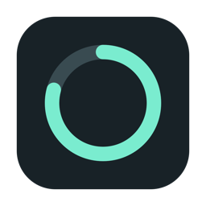

# Codex Meter



macOS、Windows、Linux 桌面额度卡片与状态栏 / 托盘工具，显示 Codex 剩余额度、重置时间和本机任务进度。

A desktop card and menu bar / tray app for Codex quota and local task progress. Native Swift on macOS; shared Electron UI on Windows and Linux.

[下载 / Download macOS · Windows · Linux](https://github.com/Haofei-Hu/codex-meter/releases/latest)

## 下载与安装

| 系统 | 下载文件 | 安装方法 |
| --- | --- | --- |
| macOS 13+，Apple 芯片 / Intel | [1.5.1.9 PKG 安装包](https://github.com/Haofei-Hu/codex-meter/releases/tag/v1.5.1.9) | 自动替换旧版、清理旧副本；保留账号与设置 |
| Windows 10/11 x64 | [1.5.2 下载页](https://github.com/Haofei-Hu/codex-meter/releases/tag/v1.5.2) · `windows-x64-setup.exe` | 运行安装向导；也提供 `portable.exe` 免安装版 |
| Linux x64 | [1.5.1 下载页](https://github.com/Haofei-Hu/codex-meter/releases/tag/v1.5.1) · AppImage | 文件属性中允许执行，双击启动 |
| Ubuntu 22.04+ / Debian 12+ x64 | [1.5.1 下载页](https://github.com/Haofei-Hu/codex-meter/releases/tag/v1.5.1) · deb | 用系统软件安装器安装，或 `sudo apt install ./文件名.deb` |

**Mac 升级请优先使用 `.pkg`**：安装到 `/Applications/Codex Meter.app`，先停止旧程序并覆盖同一路径的旧版本，安装成功后把 `/Applications` 和当前用户 `~/Applications` 中同一 bundle ID 的其他旧副本移入废纸篓。保留账号、应用偏好与任务记录，不清空废纸篓。安装失败时不会清理其他旧副本；不移除比安装包更新的版本。DMG / ZIP 仍是手动安装方式，不自动清理旧副本。

Mac 原生版当前为 **1.5.1.9**；Windows 为 **1.5.2**，Linux 为 **1.5.1**。Mac 采用系统原生弹窗材质、文字颜色和弹出／收起动画，随系统浅色／深色外观与辅助功能设置变化。设置中的“玻璃外观”可以分别调节桌面卡片和弹出面板的透明度、磨砂遮挡和浅色／深色底色，实时预览、自动保存，并支持同步参数和还原默认。所有调整值始终保留完整的系统背景模糊，磨砂最高值接近实色遮挡；桌面卡片不再使用容易从半透明边缘露出的窗口阴影。Mac 由窗口直接处理背景拖动，支持从标题、额度圆圈、文字、空白处和四周可见边缘移动卡片；设置、刷新、滚动条和右下角缩放手柄独立响应。Plus / Pro 均适用；桌面卡片按当前屏幕可用空间适配，过长内容可以滚动，顶部和底部控件保持可见。

先在本机安装并登录 Codex / ChatGPT 桌面应用，或 [Codex CLI](https://github.com/openai/codex)。每个人使用自己的账号，无需 API Key。Windows 1.5.2 会查找 Codex 桌面应用（含微软商店版）的后台程序，安装包也内置官方 Codex 0.164.0 作为备用，无需单独安装 CLI。Linux 仍需本机的 **Codex CLI**。如果没有自动找到，可在卡片设置中选择后台 `codex.exe` / `codex`（Windows 也支持 npm 的 `codex.cmd`，不能选择桌面 GUI 程序）。支持启动时设置的 `CODEX_HOME`；Meter 与 Codex 必须使用同一个系统用户和配置目录。WSL 与 Windows 的登录目录是分开的。

点击桌面卡片右上角 `···` 打开设置；拖动标题或卡片内容移动，拖动右下角调整大小。窗口会按当前屏幕自动适配；内容过多时中间区域可以滚动，标题、刷新按钮和缩放手柄保持可见。托盘点击可查看额度与工作进度，右键可退出。Linux 的点击行为由桌面环境决定，托盘菜单也提供“查看额度与工作进度”。

Windows 使用系统托盘，Linux 使用 StatusNotifierItem / Gtk 托盘。两个系统的托盘图标显示彩色额度进度条，提示文字和面板显示具体百分比；macOS 菜单栏额外支持常驻文字。GNOME 可能需要托盘扩展。Wayland 可能限制窗口定位、后台置底或透明效果；推荐在支持托盘的 X11 桌面上使用。AppImage 需要系统支持 FUSE；没有 FUSE 时可选 `.deb`。

Mac 和 Windows 包目前没有开发者正式签名 / 公证，首次打开可能出现系统提示。请从本仓库下载并核对 `SHA256SUMS.txt`；也可以审阅源码后自行构建。Mac 不需要关闭 Gatekeeper 或系统完整性保护。

三个平台均在 GitHub Actions 对应系统构建。Windows / Linux 运行真实窗口、RPC、Plus 双额度、工作进度和缩放冒烟测试；尚未人工覆盖所有硬件与 Linux 桌面环境。Mac Intel 二进制经过交叉编译，尚未在 Intel 实机验证。

## 功能

- 剩余额度百分比、重置日期和倒计时。
- Plus 的短时窗口与每周窗口上下排列；具体时长和比例以服务器返回为准。
- 绿色 → 橙色 → 红色连续渐变；菜单栏 / 托盘同步显示。
- 每 15 秒查询额度；打开面板时刷新，显示数据年龄。
- 登录变化时重新识别账号；退出后显示“等待登录”并停止额度请求。
- 桌面右下角可直接拖动缩放，也可以在设置中调节 75%–160%。
- 本机任务名称、运行/工具执行/完成/中断状态、耗时与最近公开进度，每 2 秒更新。
- 仅在任务记录含有明确计划步骤时显示步骤完成比例，不猜测任务百分比。
- 登录时启动、手动刷新、单实例保护。

## 锁屏和睡眠

目前是桌面窗口，**不是锁屏小组件**。三个系统锁屏时都不会显示桌面卡片或状态栏；解锁后可继续查看。系统进入睡眠期间不会刷新。Codex 自己的任务能否继续由 Codex 和系统电源状态决定。

## 数据来源与隐私

- 通过本机 `codex app-server` 的 `account/read`、`account/rateLimits/read` 查询账号与额度。
- 账号查询只在启动、登录变化或手动重新检测时进行；常规刷新复用连接。
- 工作进度只读本机 Codex 的 `sessions` 和 `session_index.jsonl`。这些记录格式可能随 Codex 更新而改变。
- 不直接读取或复制登录令牌，不上传任务记录，不包含分析服务或自建后端。
- 任务名称与公开进度说明会显示在用户自己的桌面。不会展示私有推理、用户消息正文、工具参数或工具结果。
- 退出登录后暂停额度查询并显示“等待登录”。默认跟随 Codex / ChatGPT 进程退出暂停；Windows / Linux 可在设置中关闭此行为，适合只使用短暂 CLI 会话的用户。

额度表示 **剩余百分比 = 100 − 已用百分比**。Codex 原应用与本工具的请求时刻可能不同，持续使用时可能暂时存在差值。服务器未返回的窗口会明确标注，不能将“未返回”理解为 0% 或 100%。

## 从源码构建

### macOS 原生版

需要 Xcode 15 或更新版本，或具备 Swift 5.9+ 的 Apple Command Line Tools。

```sh
./build.sh                            # 当前机器架构，输出到 build/
ARCHS="arm64 x86_64" ./build.sh        # 通用二进制
./scripts/test.sh                     # 本地自动测试，不修改真实登录
./scripts/package.sh                  # 创建 PKG、DMG、ZIP 并验证旧版清理逻辑
```

可用 `CODEX_METER_BUILD_DIR` 更改构建目录，用 `MACOSX_DEPLOYMENT_TARGET` 更改最低系统版本。

源码与测试位于 `Source/`，可复现的图标绘制代码位于 `Assets/MakeIcon.swift`。`--probe` 与 `--work-probe` 会只读当前账号/本机任务，适合手动排查。

### Windows / Linux

需要 Node.js 24+、pnpm 11.25。请在目标系统构建；无需开发者账号即可生成未签名安装包。

```sh
cd desktop
pnpm install --frozen-lockfile
pnpm prepare:win           # 仅 Windows：下载锁定的官方备用运行程序
pnpm test:runtime          # 仅 Windows：用临时空账号实际连接备用运行程序
pnpm test                  # 隔离的模拟账号、真实 JSONL RPC、本机任务记录测试
pnpm assets
pnpm smoke                 # 真实 Electron 窗口、Plus 双额度、工作进度、隔离和缩放测试
pnpm start                 # 使用当前用户的 Codex 账号
pnpm dist:win              # Windows：NSIS 安装包和 portable.exe
pnpm dist:linux            # Linux：AppImage 和 .deb
```

Linux 无图形界面的测试环境使用 `xvfb-run -a pnpm smoke`。安装包输出到 `desktop/dist/`。测试使用临时目录、模拟 Codex 进程或无登录的内置运行程序，不读取真实登录或任务。

跨平台界面与后端位于 `desktop/ui/` 和 `desktop/src/`，不依赖在线网页。图标从相同的 `Assets/AppIcon.png` 生成。`.github/workflows/build-desktop.yml` 在 Windows、Ubuntu 和 macOS 上测试、打包；手动运行时选择 `publish` 才会在所有平台通过后发布 Release，并生成校验文件。

## 说明

Windows 单独发布使用 `.github/workflows/release-windows.yml`，验证 Windows 运行程序和最终安装包后发布，不改变 Mac 版本。备用运行程序来自锁定的 `@openai/codex` 官方 npm 包（Apache-2.0），分开保存在 `desktop/vendor-package/`，按当前 Windows 架构打包；许可证和 NOTICE 随安装包附带。程序源码为 MIT。

Mac 专用发布使用 `.github/workflows/release-macos.yml`；四段维护版本不改变 Windows / Linux 的 npm 包版本。

独立的个人开源项目，与 OpenAI 没有隶属关系。它不会调用模型来测算额度，也不能绕过或重置账号额度。MIT License。
